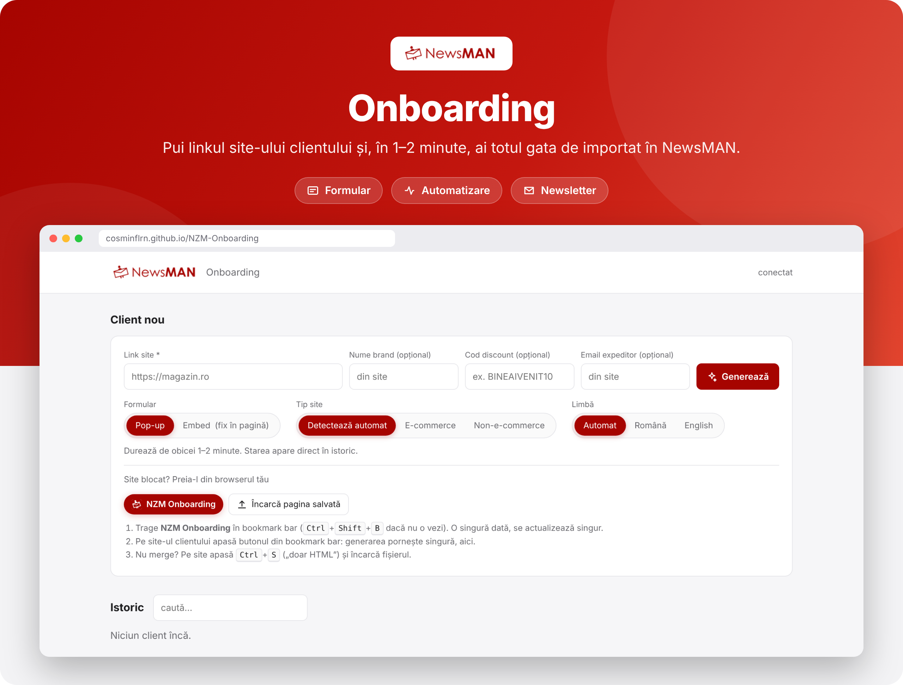

  

<h3 align="center"><a href="https://cosminflrn.github.io/NZM-Onboarding/">Deschide aplicația →</a></h3>

### Cum se folosește

1. **Generează:** pui linkul site-ului și apeși **Generează**. Logo-ul, culorile, banner-ul, linkurile, contactul și produsele se iau automat.
2. **Verifică:** **Previzualizare** pe desktop și mobil. **Editează** pentru texte, imagini sau culori, fără să mai citească site-ul.
3. **Importă:** **Descarcă** cele 3 fișiere și le imporți în NewsMAN (Formulare, Automatizări, Newslettere).

**Site blocat?** Butonul **NZM Onboarding** din bookmark bar preia site-ul din browserul tău; alegi setările și apeși Generează.

Rulează pe GitHub Pages (`docs/`), GitHub Actions (`nzm/`) și Cloudflare (`worker/`). Template-urile de bază sunt în `templates/`.
