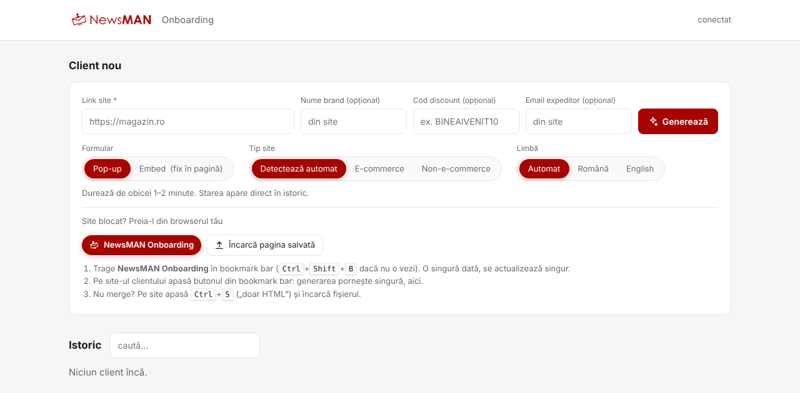

# NZM Onboarding

Pui linkul site-ului unui client și primești 3 fișiere gata de importat în Newsman: formular, automatizare și newsletter, cu logo-ul, culorile, linkurile și produsele lui.

**Pagina:** https://cosminflrn.github.io/NZM-Onboarding/ (utilizator și parolă comune echipei)

**Cum merge:** pagina e pe GitHub Pages (`docs/`). Generarea rulează în GitHub Actions (`nzm/`), iar login-ul trece prin Cloudflare (`worker/`). Template-urile de bază sunt exporturi Newsman, în `templates/`.

**Întreținere:** tokenul GitHub și parola se schimbă doar din Cloudflare ([cum](worker/README.md)). Pentru template-uri noi, le pui în `templates/` cu aceleași nume și toți clienții se regenerează singuri.
